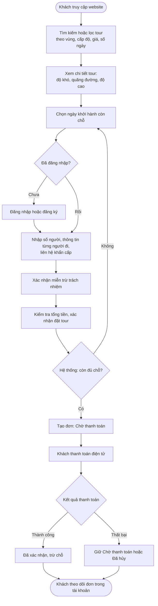
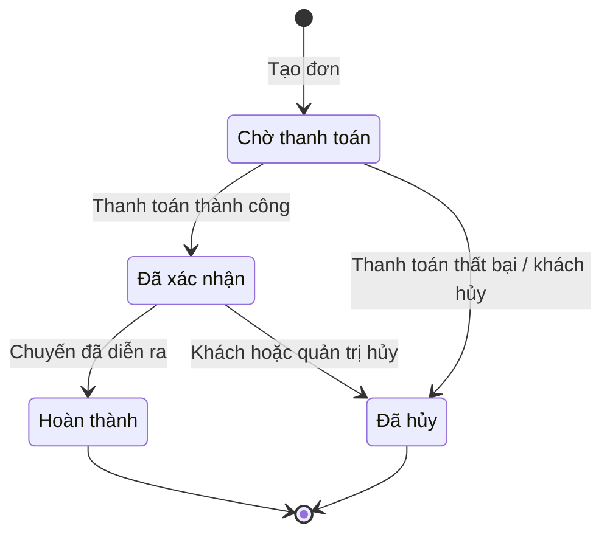

# Quy trình nghiệp vụ

## 1. Quy trình đặt tour

| Bước | Người thực hiện | Mô tả |
|---|---|---|
| 1 | Khách | Truy cập website. |
| 2 | Khách | Tìm kiếm hoặc lọc tour theo vùng, cấp độ, giá, số ngày. |
| 3 | Khách | Xem chi tiết tour và đọc độ khó, quãng đường, độ cao. |
| 4 | Khách | Chọn ngày khởi hành còn chỗ. |
| 5 | Khách | Đăng nhập hoặc đăng ký (nếu chưa có tài khoản). |
| 6 | Khách | Nhập số người, thông tin từng người đi, liên hệ khẩn cấp. |
| 7 | Khách | Xác nhận đã đọc và đồng ý miễn trừ trách nhiệm. |
| 8 | Khách | Kiểm tra tổng tiền, xác nhận đặt tour. |
| 9 | Hệ thống | Kiểm tra lại số chỗ còn, tạo đơn trạng thái "Chờ thanh toán". |
| 10 | Khách | Thanh toán điện tử. |
| 11 | Hệ thống | Nhận kết quả: thành công thì chuyển "Đã xác nhận" và trừ chỗ; thất bại thì giữ "Chờ thanh toán" hoặc chuyển "Đã hủy". |
| 12 | Khách | Theo dõi đơn trong tài khoản. |

### Sơ đồ quy trình

## 2. Trạng thái đơn

| Trạng thái | Ý nghĩa | Chuyển sang |
|---|---|---|
| Chờ thanh toán | Đã tạo đơn, chưa trả tiền | Đã xác nhận, Đã hủy |
| Đã xác nhận | Thanh toán thành công, đã giữ chỗ | Hoàn thành, Đã hủy |
| Hoàn thành | Chuyến đã diễn ra | Kết thúc |
| Đã hủy | Khách hoặc quản trị hủy | Kết thúc |

### Sơ đồ trạng thái

